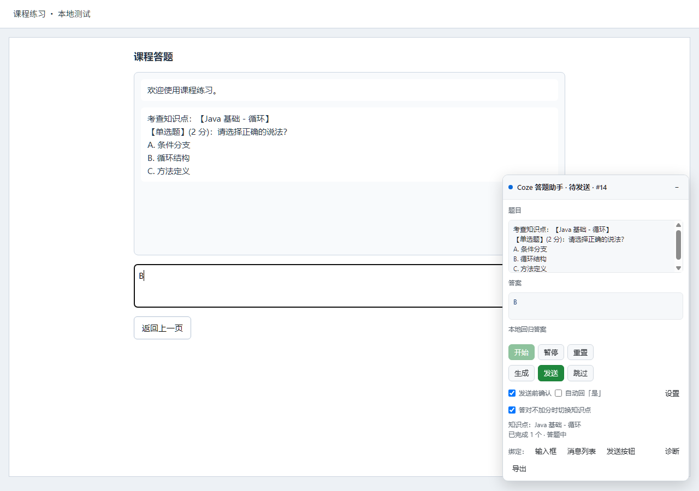

# Coze-Agent-Question-Practice-Plugin

Chrome MV3 扩展：识别 Coze 课程对话中的题目，通过你配置的模型生成答案并填入输入框。默认开启发送前确认，由你核对后点击发送。

当前源码构建：**2026-10-29 #14 chapters**。

## 本轮状态

真实 Coze 页面已由 #13 完成“识别题目 → 模型生成 → 填入真实输入框”，实际答案为 A：大，面板与输入框一致，确认模式未自动发送。按用户 2026-10-29 的最新口径，本轮真实验证通过。

#14 增加章节切换，最终七套离线 Chrome 回归 163/163 通过，其中章节与绑定 53/53。真实判分和换章后的出题留待 Coze 智能体恢复后下一轮测试；本轮不再追加真实 Coze 请求。浏览器中已加载的 #13 不会因文件修改自动升级，下轮测试前刷新扩展和页面，核对面板 #14。

## 安装与设置

1. 在 Chrome 的 chrome://extensions 或 Edge 的 edge://extensions 打开开发者模式。
2. 下载或克隆此仓库，加载已解压扩展，选择包含 manifest.json 的项目根目录。
3. 点击扩展图标打开设置，填写接口地址、API Key 和模型名，点击“授权访问接口地址”。
4. 配置后可点击“测试连接”。已有本地配置也可通过设置页“从本地配置导入”导入。

本地私有配置为 tools/env.local.json，格式见 tools/env.local.example.json。后台首次初始化会补齐本地配置中的缺失项，该文件不作为网页可访问资源。密钥用于后台模型请求；不得将真实配置、身份信息或 output 目录打包进公开提交。课程登录可配置学号、姓名；平台账号登录由用户操作。

## 使用

1. 登录 Coze 并进入课程答题页，点击面板“开始”。
2. 等待答案填入，核对后点击“发送”。
3. 看到继续提示时，面板会准备“是”，仍需确认发送。
4. 如果本轮判分明确答对且新增积分为 0，扩展自动返回知识点页、选择下一个未完成知识点并开始答题。新题生成后仍等待确认。

章节判断支持“你的答题结果是：正确”和“本题得分：0”等明确字段；若同时出现“新增积分”，优先采用新增积分。缺失分值、答错零分、历史反馈和资源点不足均不会被当作章节封顶。下拉框无数据时停止并提示，不假报全部完成。

| 开关 | 默认 | 行为 |
| --- | --- | --- |
| 发送前确认 | 开 | 生成并填入后等待点击发送 |
| 自动回“是” | 关 | 仅在关闭确认并打开此项后自动发送继续回复 |
| 答对不加分时切换知识点 | 开 | 排除当前、已完成和禁用项；无剩余可用项时停止 |
| 自动生成 / 自动填入 | 开 / 开 | 识别稳定题目后生成并填写 |
| 最大轮数 | 100 | 答案和“是”都计为一次提交，跨章节保留累计值 |

“暂停”使尚未完成的生成和导航动作失效；“开始”可恢复暂停的草稿或章节导航。“重置”清空本次答题及章节进度。进度按浏览器会话中的标签页和 Coze 应用隔离保存，刷新可恢复，关闭浏览器后不保证保留。

## 识别与手动绑定

面板“诊断”读取实际内容 iframe 的消息、输入框与分类结果。识别不准时可点击“输入框 / 消息列表 / 发送按钮”，再点页面内对应元素，Escape 取消；拾取时面板暂时隐藏，结束自动恢复。操作会暂停答题，绑定完点击“开始”继续。

“导出”用于本地排查，密钥和已配置的学号姓名会脱敏。Coze 页面结构变化时，可用诊断和手动选择器重新适配。

## 测试

需要本机 Chrome 和 Node 22+，无需安装 npm 依赖。本机已验证 Node 24.9.0。

    node tests/run-all.js --offline
    node tests/run-chapters.js
    node tests/run-all.js

第一条运行七套离线 Chrome 测试。第二条单独验证判分、章节导航、暂停恢复、iframe 重建、进度隔离与绑定交互。第三条额外运行 run-live.js，会调用一次已配置的真实模型，但对话页仍是本地夹具。

随本版本提交的[测试汇总](docs/verification/2026-10-29.json)为 163/163，通过范围详见[任务与验证](specs/tasks.md)。运行测试会在本机 output/tests/latest/ 生成最新汇总、逐项用例和日志；真实账号页面的截图、浏览器记录和备份只在本机保留。

下图来自使用虚构测试数据的本地章节夹具，展示换章后生成填写并等待确认的状态：

## 下一轮真实验证

等智能体恢复后，刷新扩展和真实页面，核对 #14，再验证：真实判分零新增分 → 返回 → 选择新知识点 → 出现新题 → 生成填写 → 等待确认。

tests/real-session.js 提供 state、prepare、login、generate、send、pause、screenshot 命令，可用 --help 查看。该脚本仅适用于已有独立 Chrome 调试会话监听 127.0.0.1:9222；本轮受管浏览器不提供此端口，不必因此重启或关闭用户现有 Chrome。generate 与 send 是独立动作。

## 代码导航

| 文件 | 作用 |
| --- | --- |
| src/core/engine.js | 稳定消息、异步生命周期、生成、确认发送、累计轮数 |
| src/core/chapters.js | 判分、完成集合、可取消章节导航与恢复 |
| src/core/detect.js / fill.js | DOM 定位、完整填写回读、发送清空校验 |
| src/content/main.js / bus.js | 装配与后台按标签页中转跨 frame 消息 |
| src/content/panel.js | Shadow DOM 面板、章节状态、操作与绑定 |
| src/background.js | 模型请求、私有配置、会话进度 |
| src/options/ | 模型、行为、登录和选择器设置 |
| tests/ | 本地 Chrome 集成测试及真实会话辅助命令 |
| specs/ | 需求、设计、任务和验收证据说明 |

接手开发先读 [AGENTS.md](AGENTS.md)、[HANDOFF.md](HANDOFF.md) 和 specs/。仓库为 [grey7213/Coze-Agent-Question-Practice-Plugin](https://github.com/grey7213/Coze-Agent-Question-Practice-Plugin)，主分支 main。
